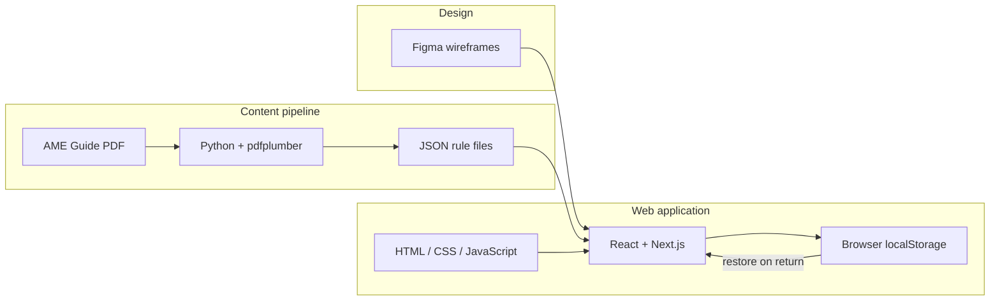

# Ticket 2 — Step 1.a: Identify Technologies

**File naming (Canvas):** `GROUPID_Ticket2...` *(replace `GROUPID` before upload)*

---

## 1. Identifying information

| Field | Value |
| --- | --- |
| Course | CS-4273 Capstone — Fall 2026 |
| Ticket | Ticket 2 — Technologies, Documentation, and Unit Tests |
| Step | 1.a — Identify Technologies (Group Work) |
| Project | Pilots Guide to Medical Certification |
| STEM College / Category | Physical Sciences / Health & Biological Sciences |
| Group ID | Group F |
| Team members | *[list names before submit]* |
| Date | September 1, 2026 |

---

## 2. Purpose

As a group, we identified technologies that could be used to build the **Pilots Guide to Medical Certification** system. Selections are grounded in:

- Ticket 1 domain understanding (pilot education, FAA-accurate content, MedXPress → AME workflow)
- The [Capstone project proposal](../../../Resources/Capstone%20project%20proposal.pdf) (responsive web app, guided wizards, searchable AME Guide content, WCAG accessibility, no real PII in prototype)
- Prior OU team work (Fall 2025 / Spring 2026): Python PDF parsing, JSON rule structures, and HTML prototypes
- Project constraints: continue prior research, design for possible FAA Office of Communication integration

---

## 3. Identified technologies

We identified **six** technologies across programming languages, frameworks, design tools, and client-side persistence.

### 3.1 Python (programming language)

**Role:** Backend processing, content pipeline, and automated testing.

**Why it fits this project:**

- Spring 2026 prior work already uses Python for deterministic, auditable extraction of AME Guide disposition rules (`AMEParser.py`, `AMESubset.py`) via **pdfplumber** and **pypdf**.
- Outputs structured **JSON** grouped by medical condition — a natural content layer for pilot-facing checklists and decision-support tools.
- **pytest** is already in use (`AMEParserTests.py`) for unit testing parsing logic.

**Example use in our system:**

- Parse updated AME Guide PDFs when FAA releases new guidance
- Preprocess JSON content for the web frontend
- Run validation checks on rule data before it is published to the site

---

### 3.2 JSON (data format / content tool)

**Role:** Structured, machine-readable storage for AME Guide rules and pilot-facing content.

**Why it fits this project:**

- Already produced by the Python pipeline (`ame_subset.json`, `pilot_entry.sample.json`).
- Separates **approved medical content** from presentation code — important when FAA guidance updates.
- Gives the frontend and unit tests a single deterministic data contract.
- Prior teams used JSON to demonstrate feasibility to FAA stakeholders.

**Example use in our system:**

- Condition → cases → checklist / decision / follow-up time structures
- Versioned content bundles the team can swap when the AME Guide changes
- Schema for wizard inputs and saved user progress (when serialized to browser storage)

---

### 3.3 HTML, CSS, and JavaScript (programming languages)

**Role:** Foundation for web presentation and interactive pilot/AME workflows.

**Why it fits this project:**

- The core deliverable is a **web platform** that new pilots can find, navigate, and trust.
- Prior prototypes (`ame_form.html`, `ame_certification_form.html`) already load `ame_subset.json` and render condition-specific forms in the browser.
- HTML provides semantic structure for accessibility (WCAG); CSS handles responsive, mobile-friendly layout; JavaScript drives interactivity.
- These languages underpin **React + Next.js** — React components compile to HTML/CSS/JS, and custom behavior still relies on JavaScript APIs (e.g., browser storage for auto-save).

**Example use in our system:**

- Guided “preflight your medical” checklists
- Condition-specific documentation prompts
- Interactive flows explaining issue / defer / deny outcomes
- Client-side read/write of saved wizard state via `localStorage` or `sessionStorage`

---

### 3.4 React with Next.js (web framework / platform)

**Role:** Structured, scalable frontend application platform.

**Why it fits this project:**

- The proposal calls for a **modern, responsive prototype** with clear navigation, accessibility (WCAG), and fast load times.
- Component-based UI suits reusable patterns: wizard steps, disposition tables, AME locator links, and status explainer cards.
- Server-side rendering and static generation can improve performance and SEO so pilots can **find** the guide easily.
- Aligns with potential future integration into a larger FAA web presence (Office of Communication).
- React state management pairs naturally with auto-save: debounced writes to browser storage as the user moves through the wizard.

**Example use in our system:**

- Multi-step medical history wizard with **auto-save** (prototype — no real PII)
- Searchable, filterable views of AME Guide excerpts
- Accessible layout patterns (semantic HTML, keyboard navigation, ARIA)

---

### 3.5 Figma (design tool)

**Role:** UI/UX design, wireframes, and prototyping before implementation.

**Why it fits this project:**

- The Capstone proposal lists **Figma + simple frontend** as part of the research and design methodology.
- Lets the group test navigation, wizard flows, and plain-language layouts with stakeholders before writing production code.
- Supports an iterative design process aligned with international reference sites (CASA, UK CAA, Transport Canada) studied in Ticket 1.
- Design tokens and component specs in Figma can guide consistent implementation in React.

**Example use in our system:**

- Wireframes for the medical history wizard and outcome explainer flows
- Mobile and desktop layout variants for responsive design review
- Shared mockups for mentor feedback on usability and FAA-acceptable presentation

---

### 3.6 Browser storage — `localStorage` / `sessionStorage` (client-side persistence)

**Role:** Auto-save user wizard progress in the prototype without a server database.

**Why it fits this project:**

- The proposal calls for a guided medical history wizard with **auto-save** and **previous-application recall**.
- The prototype must not collect real PII; keeping draft answers in the **user’s own browser** avoids server-side storage for now.
- `localStorage` persists across sessions (user can close the tab and return); `sessionStorage` clears when the tab closes — the group can choose based on privacy preference.
- Saved state can be stored as serialized **JSON**, matching the content format used elsewhere in the stack.

**Example use in our system:**

- Auto-save wizard step answers as the pilot types or moves between steps
- Restore in-progress forms on return visit
- Export/import saved JSON (similar to the existing `ame_form.html` “Save inputs to JSON file” pattern)

**Open question for mentor:** Whether the final system should use a **server-side database** (e.g., for cross-device sync or account-based recall) or remain browser-only for the prototype. We will confirm with the mentor before adding backend persistence.

---

## 4. Technology summary

| # | Technology | Category | Primary project use |
| --- | --- | --- | --- |
| 1 | Python | Programming language | AME Guide PDF parsing, JSON pipeline, backend logic, pytest |
| 2 | JSON | Data format / tool | AME rule content, wizard schemas, serialized save data |
| 3 | HTML / CSS / JavaScript | Programming languages | Web UI foundation, interactivity, responsive layout |
| 4 | React + Next.js | Web framework / platform | Accessible, navigable prototype application with wizard auto-save |
| 5 | Figma | Design tool | Wireframes, UX prototypes, stakeholder review |
| 6 | Browser storage (`localStorage`) | Client-side persistence | Auto-save wizard progress without server database (pending mentor input) |

---

## 5. How technologies work together

**Flow:** Figma defines the UX before implementation. Python extracts AME Guide rules into JSON. React + Next.js (built on HTML/CSS/JS) renders guided flows and checklists from that JSON. As users complete the wizard, progress auto-saves to browser storage as JSON — no server database unless the mentor directs otherwise.

---

## 6. Technologies considered but deferred

| Technology | Reason deferred |
| --- | --- |
| Server-side database (PostgreSQL, etc.) | **Pending mentor clarification.** Browser storage covers prototype auto-save; a database may be needed later for cross-device sync or accounts. |
| LLM / AI APIs | Prior teams explored AI-assisted search; may revisit after core site and content pipeline are stable. Not in the current stack. |
| Mobile native (iOS/Android) | Proposal targets responsive **web**; mobile web meets “mobile-friendly” requirement |
| MedXPress API integration | No public API; we link to MedXPress and focus on education/prep |

---

## 7. Next steps (for later Ticket 2 steps)

- **Mentor:** Confirm whether wizard auto-save should stay browser-only or move to a server-side database.
- **Step 1.b (individual):** Each member picks learning resources for 2–3 technologies from this list.
- **Step 1.c (group):** Finalize the stack in the GitHub README and document one key feature (likely the wizard with auto-save).
- **Step 1.d (group):** Write unit tests for that feature in three languages (e.g., Python, JavaScript, and a third such as TypeScript or Java).

---

## 8. References

1. Federal Aviation Administration. *Guide for Aviation Medical Examiners*. https://www.faa.gov/ame_guide  
2. OU Capstone — *Pilots Guide to Medical Certification* project brief. `Resources/Project info.md`  
3. OU Capstone — *Prototype of an Improved FAA Aviation Medical Certification Information Portal*. `Resources/Capstone project proposal.pdf`  
4. Prior semester codebase — `Spring2026/Capstone2026-main/` (`AMEParser.py`, `ame_form.html`, `ARCHITECTURE.md`)  
5. Ticket 1 submission — `Assignments/Group/Ticket_1/submission/GroupF_Ticket1DomainUnderstanding_CS4273Fall2026.pdf`
