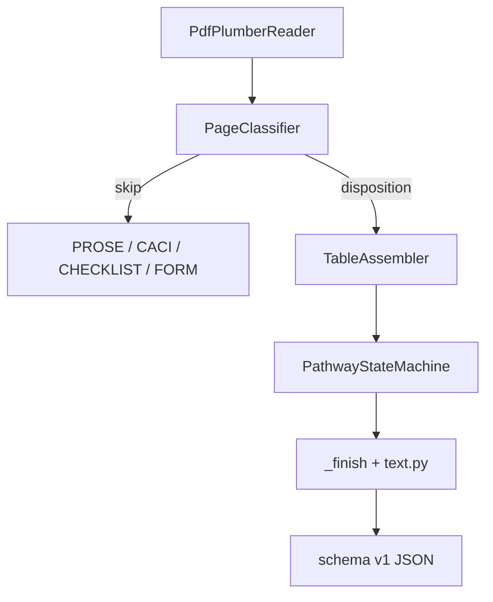

# AME Parser

The production parser is in `src/packages/ame_parser/`. The prior-semester
implementation remains unchanged in `src/legacy/old/` for characterization tests.
App-facing normalized JSON is written to gitignored `src/data/guidance/content/`
for the Vite UI (or fetched from the private companion repo via
`scripts/fetch-guidance.mjs`).

## Purpose and safety boundary

The parser converts FAA AME Guide and OneGuide PDF tables into deterministic,
source-traceable JSON for the pilot-facing search application. It does not make
medical decisions. Each record retains the raw disposition and source wording.
Unrecognized wording becomes `UNKNOWN`; it is not guessed.

`Requires FAA Decision` is the only reviewed non-literal mapping. It maps to
`DEFER` and carries the warning `requires_faa_decision_mapped_to_defer` so the
transformation remains visible.

## Install and run

```powershell
python -m pip install -e ".[dev]"
python src/scripts/capstone.py fetch-guidance --with-pdfs
python src/scripts/capstone.py parse --input ame_guide.pdf --pages 64-100
python -m ame_parser Documentation/Resources/ame_guide.pdf --pages 64-100 `
  --output src/data/guidance/content/ame_guide.normalized.json --diagnostic
```

For OneGuide:

```powershell
python -m ame_parser Documentation/Resources/OneGuide_Neurology.pdf --pages 5-14 `
  --output src/data/guidance/content/OneGuide_Neurology.normalized.json --diagnostic
```

Use `--strict` in validation jobs where any parser warning must fail the run.
Generate the machine-readable contract with:

```powershell
python -m ame_parser --schema schemas/ame-parser-v1.schema.json
```

Exit codes are `0` for success, `2` for invalid input, `3` for an unsupported
document, and `4` for strict validation failure.

## Architecture

The parser uses a staged pipeline:

1. `PdfPlumberReader` adapts PDF pages to framework-independent `PageData`.
2. `AmeParser` selects an extractor from deterministic content signatures.
3. **AME Guide path** (`AmeGuideExtractor`):
   - `page_types.classify_ame_page` labels each page (`DISPOSITION_TABLE`,
     `CONTINUATION_DISPOSITION`, `CHECKLIST_EXAM`, `CACI_WORKSHEET`,
     `STATUS_FORM`, prose, etc.).
   - Only disposition roles are extracted; checklists, CACI worksheets, forms,
     and admin prose are skipped.
   - `table_assemble` maps headers by **label** (not physical column count),
     selects the primary table on fragmented pages, and merges ghost
     fragment tables into the active pathway’s evaluation text.
   - A page-to-page state machine carries `condition` / `category` across
     continuation pages and flushes new condition blocks from `ITEM` /
     ALL-CAPS title lines.
4. **OneGuide path** (`OneGuideExtractor`) still targets the pilot trio
   (`Disease/Condition`, `Evaluation Data`, `AME Actions`) and ignores
   AAM/VHT/ATCS/DOC columns. It can later reuse the same page-classifier
   utilities; it is a separate layout family (landscape, multi-audience).
5. Shared `text` helpers normalize lists, strip ordering markers, and classify
   only reviewed disposition wording.
6. Contract validation and stable JSON serialization complete the pipeline.



The extractor registry is a Strategy pattern. The PDF reader is an injected
port/adapter, allowing tests to exercise extraction without loading PDFs.
Adding a format means implementing the `Extractor` protocol and registering
the strategy; shared models and serialization do not change.

## Normalized contract

The top-level object identifies `schema_version`, parser version, source
document, processed-page count, warnings, summary counts, and records.
Each record contains:

- condition, optional category/sub-condition, scenario, and certificate classes;
- time constraints with relational wording preserved, such as
  `less than 5 years` and `no more than 90 days`;
- normalized and raw disposition;
- typed requirements (`DOCUMENT`, `TEST`, `MEDICATION`, `EVALUATION`, `OTHER`);
- medication notes and action text;
- raw source text;
- PDF/printed page and section reference;
- record-specific warnings.

Stable ordering and sorted JSON keys make repeated runs byte-for-byte
comparable.

## UI consumption

The Vite app loads **every** `*.json` file under `src/data/guidance/content/`
at startup (via `import.meta.glob`), merges them through `src/packages/content`,
and de-duplicates pathways before grouping into conditions. If `content/` is
empty, it falls back to synthetic files under `src/data/guidance/samples/`.
Records that share the same condition + pathway + disposition (or the same
`record_id`) collapse to the richer copy.

Repeating source phrases are treated as classifiers, not checklist content:

- `Submit the following for FAA review` / `It must include` → section headers (dropped)
- Trailing `DEFER` / `ISSUE` tokens → disposition field only
- Leading `A.` / `B.` / `1.` / bullets → ordering only (stripped for display)

Numbered and lettered lists are expanded into separate requirement rows with
markers removed so the UI shows plain checklist language. The adapter then:

- assigns browse categories from `src/data/guidance/category_dictionary.json`
  (exact titles, ITEM numbers, aliases, then keyword patterns);
- humanizes condition labels for display;
- keeps pathway titles short **without** letter prefixes;
- expands bulleted evaluation text into checklist items;
- excludes AME inquiry prose from the bring-list;
- surfaces only short medication notes from action text.

Edit `category_dictionary.json` to change browse buckets without re-tuning the
PDF heading heuristics. Exact `condition_map` entries win over patterns.

Drop a new `*.json` (same `NormalizedGuidanceFile` shape) into
`src/data/guidance/content/` — including future `conditions/<slug>.json` —
and restart the dev server; no code change is required to pick it up. Update
the private companion `manifest.json` when publishing new files for fetch.

Medication catalog entries remain curated until a dedicated medication parse
exists.

## Tests

```powershell
python -m pytest
python -m pytest --cov=ame_parser --cov-report=term-missing
```

The suite includes pure unit tests, schema/invariant tests, table-adapter
fixtures, malformed/encrypted input tests, deterministic serialization,
human-reviewed golden records, real-PDF integration tests, and legacy
characterization tests.

## Known limitations

- The production strategies currently target AME Guide disposition tables and
  OneGuide initial pilot certification columns. Internal AAM, VHT, ATCS, and
  DOC workflow columns are intentionally excluded from pilot-facing records.
- Non-disposition AME pages (exam checklists, CACI worksheets, status forms,
  FAQs, revision history) are classified and skipped; they are not pathway
  sources.
- Image-only/scanned PDFs require OCR before parsing.
- Requirement typing is keyword-based; raw evaluation wording is retained so
  a reviewer can correct or extend classification rules safely.
- Headerless AME continuation rows reuse the prior page’s logical column map;
  unrelated narrow fragment tables are merged into evaluation text when
  possible.
- Starting a page range in the middle of a multi-page condition can omit the
  heading or earlier requirement text. Include the condition's title page.
- FAA layout or wording changes can produce warnings or golden-test failures
  and require a reviewed extractor update.

## OneGuide follow-on

OneGuide Neurology remains a separate Strategy. A later migration can route
OneGuide pages through shared `page_types` helpers (condition-start vs
continuation vs notes) while keeping the pilot-column projection. Do not
force OneGuide’s 6–7 column landscape grids through the AME logical 3/4-col
assembler.
