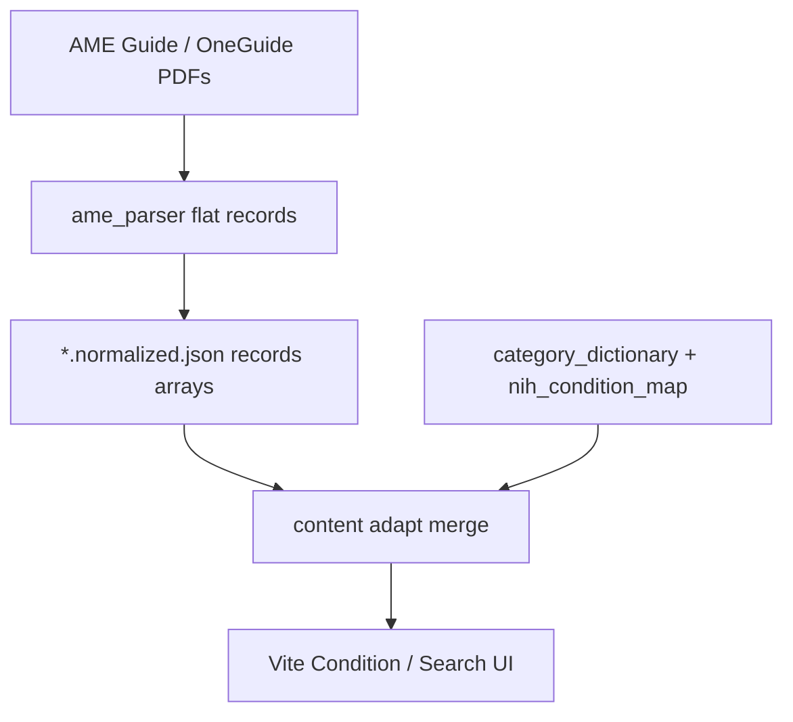

# Outline: issues with current FAA guidance data and a proposed structure

Issue [#39](https://github.com/Colby-Frison/Capstone-Fall2026/issues/39) — find weak points in how AME / OneGuide content is organized today, and outline a cleaner layout the FAA (and this Capstone) could adopt.

This document is a **proposal for stakeholders**, not a mandate to rewrite the live app in one step. It is grounded in what this repository already extracts, stores, and displays.

## Audience and goal

| Audience | Need |
| --- | --- |
| FAA / CAMI content owners | A publishable information architecture that pilots and AMEs can navigate without PDF archaeology |
| Capstone / future maintainers | A target model that reduces parser heuristics and UI merge logic |
| Pilots (end users) | Stable condition pages: clear pathways, paperwork, and provenance |

**Goal:** move from “PDF table rows glued into JSON” toward **condition-centric, pathway-aware, provenance-complete** guidance.

---

## How data is organized today (this repo)



| Layer | Location | Shape |
| --- | --- | --- |
| Source | Local gitignored PDFs | Examiner-oriented tables and prose |
| Extract | `src/packages/ame_parser/` | One **record ≈ one table pathway row** |
| Store | `src/data/guidance/*.normalized.json` | Monolithic `records[]` (e.g. ~417 AME Guide rows) |
| Browse taxonomy | `category_dictionary.json` | Post-hoc maps / aliases / patterns |
| NIH identity | `nih_condition_map.json` | Sidecar keyed by adapted condition id |
| Alternate layout | `ParsePDFChuckes/2_website_data/conditions/` | One JSON file per condition (Ticket 9 / #20) |

The pilot UI already thinks in **conditions → pathways → disposition / bring-list**. The stored AME extract still thinks in **flat rows**, so adapters must merge, rename, and paper over gaps.

---

## Weak points in the current organization

### 1. Flat rows vs real hierarchy

FAA guidance is hierarchical (exam item / disease → clinical situation → class → outcome → materials). The production extract is a flat `records[]` with repeated `condition` strings. The UI must group and de-duplicate. A parallel condition-centric tree already exists under `ParsePDFChuckes/2_website_data/`, which shows the product wants a different root entity than the parser emits.

### 2. Unstable and uneven condition titles

The same exam area appears as short codes (`NOSE`), multi-word headings (`SINUS CONDITIONS`), and related but separate labels (`ALLERGIES`). Slugs in `record_id` sometimes disagree with the `condition` field. Truncation from PDF line wraps still appears (e.g. ALS / Lou Gehrig titles cut mid-parenthesis; scenario text ending mid-sentence).

### 3. `scenario` and `subcondition` mean almost the same thing

Many rows copy the same string into both fields. Downstream code treats them interchangeably. “Pathway” (what the pilot picks) and “table row label” (A/B/C in the PDF) are not distinct concepts in the schema.

### 4. Categories are reconstructed, not authored

Browse categories come from `category_dictionary.json` heuristics (`condition_map`, `alias_map`, patterns). Source `section` text from the PDF can disagree with the derived `category`. Catch-alls such as `"Other"` mix taxonomy with “condition not listed” logic.

### 5. Cross-references become UNKNOWN dead ends

“See … table/protocol” rows often land as `disposition: UNKNOWN` with a `cross_reference` warning and a requirement that is only a pointer. Pilots cannot follow the graph to the target pathway inside the dataset.

### 6. Disposition vocabulary is overloaded

Literal ISSUE / DEFER / DENY / SPECIAL ISSUANCE sit beside mapped values (`Requires FAA Decision` → DEFER with a warning) and structural UNKNOWN. Without a `disposition_kind`, UIs must infer meaning from warnings.

### 7. Schema contract lags the emitted JSON

`schemas/ame-parser-v1.schema.json` omits several fields the pipeline writes (`category`, `subcondition`, `action`, `medication_notes`, richer `source`, requirement object shape). Validation under-specifies what producers and consumers must agree on.

### 8. Important AME artifacts are out of band

CACI worksheets, status forms, checklists, and many protocols are skipped by the disposition-table extractor (by design for the Capstone MVP). Pilots still need those linked assets; today they are not first-class nodes on the condition.

### 9. Table layout artifacts leak into content

Stacked certificate-class rows and fragmented tables produce warnings such as `stacked_table_row_split` and broken requirement prefixes. Certificate class is sometimes a chip list, sometimes buried in prose—not a reliable dimension of every pathway.

### 10. Provenance is incomplete for publishing

PDF page is usually present; printed page and stable table/row anchors are not consistently required. Without those, FAA editors cannot map a website change request back to a precise source cell.

---

## Proposed target structure (FAA-facing)

Adopt a **condition bundle** as the unit of authorship and publication. Flat pathway extracts can remain a derived interchange format for parsers.

### Core entities

```text
ExamItem (FAA item / chapter)
  └── Condition (stable id + display title)
        ├── aliases / consumer names (optional NIH bridge)
        ├── pathways[]
        │     ├── clinical_situation (pilot-facing label)
        │     ├── certificate_classes[]
        │     ├── disposition { normalized, raw, kind }
        │     ├── time_constraints[]
        │     ├── bring_list[] / ame_review[] / medication_notes[]
        │     └── source { document, pdf_page, printed_page, section, table_id, row }
        ├── linked_resources[]  (CACI, protocols, forms, FAQs)
        └── cross_references[]  (typed edges to other conditions / resources)
```

### Field rules (summary)

| Concern | Proposal |
| --- | --- |
| Identity | Stable `condition_id` separate from display `title`; never derive id only from a truncated PDF cell |
| Pathway | One object per selectable situation; no duplicate `scenario`/`subcondition` |
| Disposition | Keep enum for filters; add `kind`: `literal` \| `requires_faa_decision` \| `see_elsewhere` \| `missing`; always keep `raw` |
| Cross-ref | Typed edge with `target_condition_id` / `target_resource_id` — not UNKNOWN + prose only |
| Category | Primary = FAA exam-item taxonomy; alias dictionary only for search synonyms |
| Requirements | Structured items with `kind`, `required`, `role` (`bring_list` vs `ame_review`) — already partially present in the UI adapter |
| Provenance | Require document + pdf_page; prefer printed_page + table/row when available |
| Resources | Protocols / CACI / forms as `linked_resources`, not skipped orphans |

### Example (illustrative)

```json
{
  "condition_id": "acoustic-neuroma",
  "title": "Acoustic Neuroma",
  "exam_item": "Neurologic",
  "pathways": [
    {
      "pathway_id": "acoustic-neuroma-stable",
      "clinical_situation": "Stable after treatment…",
      "certificate_classes": ["All"],
      "disposition": {
        "normalized": "DEFER",
        "raw": "Requires FAA Decision",
        "kind": "requires_faa_decision"
      },
      "bring_list": [],
      "source": {
        "document": "ame_guide.pdf",
        "pdf_page": 120,
        "section": "Neurologic"
      }
    }
  ],
  "cross_references": [],
  "linked_resources": [
    { "type": "form", "id": "8500-x", "title": "…" }
  ]
}
```

---

## Migration path (practical)

1. **Document the contract** — expand JSON Schema (or publish a v2 schema) to match what adapters already need.
2. **Emit condition bundles** — prefer the `ParsePDFChuckes/2_website_data/conditions/` direction (#20) as the canonical site input; keep flat records as a parser debug/export.
3. **Fix cross-references** — resolve “See …” rows to target ids during parse or a link-check pass.
4. **Authoritative categories** — replace heuristic-only browse taxonomy with exam-item codes plus curated aliases.
5. **Surface disposition kind** in the UI so mapped DEFER / see-elsewhere is never confused with a literal table cell.
6. **Link resources** — attach forms and CACI/protocol stubs as data, not only as free text in requirements.

---

## What this Capstone already does well

- Deterministic dispositions with `raw_disposition` retained.
- Source-backed UI that refuses to invent medical advice.
- NIH identity as a **sidecar**, not a replacement for FAA outcomes (#32 / #33).
- Grouped bring-lists and pathway switching in the condition detail UX.
- Explicit privacy split: public normalized JSON, private source PDFs ([Guidance_Data_Privacy.md](./Guidance_Data_Privacy.md)).

Those pieces should survive; the proposal is to **align storage with the UI’s mental model** and give the FAA a clearer authoring shape.

---

## Out of scope for this outline

- Live connection to an underlying FAA operational database (future).
- Personalized certification decisions or MedXPress integration.
- Replacing NIH educational links with FAA policy text.

## Related issues

| Issue | Relation |
| --- | --- |
| [#20](https://github.com/Colby-Frison/Capstone-Fall2026/issues/20) | Per-condition JSON / smaller PDF chunks |
| [#35](https://github.com/Colby-Frison/Capstone-Fall2026/issues/35) | Clean demo content for Neurology / Nose and Sinuses |
| [#48](https://github.com/Colby-Frison/Capstone-Fall2026/issues/48) | Public JSON vs private PDFs |
| [#33](https://github.com/Colby-Frison/Capstone-Fall2026/issues/33) | NIH educational layer on detail (does not replace FAA structure) |
