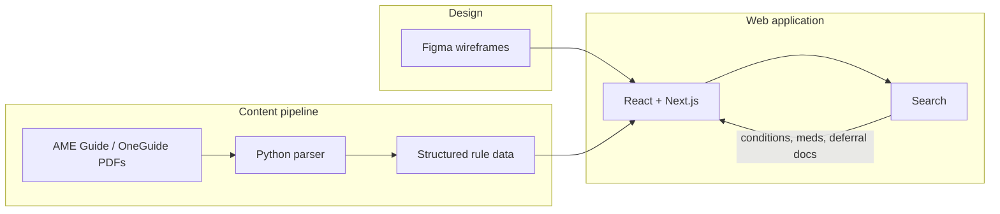

# Pilots Guide to Medical Certification

**CS-4273 Capstone - Fall 2026 | Group F**

A web platform that helps pilots find clear answers about FAA medical certification — medical conditions and sub-conditions, likely outcomes (issue, deferral, or denial), paperwork and tests for deferrals, and how medications affect flight status.

This project continues work from prior OU Capstone teams (Fall 2025 / Spring 2026) and is designed for possible integration with the FAA Office of Communication. Content must stay accurate, easy to find, easy to understand, and encouraging.

---

## Problem

FAA medical guidance is dense. Newer pilots often cannot tell what a condition means for their certificate, what an Aviation Medical Examiner (AME) will need, or whether a medication will ground them. Applicants with medical histories — including mental health concerns — sometimes assume a piloting career is over before it starts.

Common pain points:

- Finding accurate information among conflicting sources
- Identifying a condition and its related sub-conditions
- Knowing whether disclosure likely leads to issue, deferral, or denial
- Understanding deferral paperwork and tests early enough that approval is not delayed
- Checking how medications affect flight status
- Decoding medical terminology in plain language

---

## Goals

- Build a pilot-facing web platform within an **FAA-acceptable framework**
- Make medical certification information searchable and easy to navigate
- Present conditions, outcomes, deferral requirements, and medication guidance in plain language
- Ground content in official FAA sources (parsed from AME Guide and related PDFs) and mentor-approved material
- Emphasize: get healthy first, see personal physicians for concerns, then pursue the medical certificate

---

## What we are building

The core product is **data presentation and search**. Pilots should be able to look up what they need and leave with a clear answer.

**Search-first access**

- Search across medical conditions, sub-conditions, medications, and related guidance
- Surface the right slice of AME Guide content without reading hundreds of PDF pages

**Condition and outcome clarity**

- Show how conditions and sub-conditions map to likely dispositions: **issue**, **deferral**, or **denial**
- Explain what each outcome means in practical terms for the pilot

**Deferral readiness**

- When a deferral is likely, list associated paperwork, tests, and documentation
- Help pilots gather what they need before (or right after) the AME visit so approval is not delayed by missing records

**Medications and flight status**

- Present how taking a medication can affect flight status and medical certification
- Make medication-related guidance findable alongside condition guidance

**Content source**

An external database already holds this information in structured tables. For this semester we will **parse the same information from official PDFs**, with possible integration to the database in the future. Parsed content becomes structured data the app can search and display.

---

## Technologies

| Technology | Role |
| --- | --- |
| **Python** | PDF parsing, structured content pipeline, automated tests |
| **JSON** (or similar structured data) | Conditions, sub-conditions, dispositions, deferral requirements, medication notes |
| **HTML / CSS / JavaScript** | Web UI foundation, interactivity, responsive layout |
| **React + Next.js** | Searchable, accessible presentation layer |
| **Figma** | Wireframes, UX prototypes, stakeholder review |

### How they fit together



See [Step 1.a technology document](Assignments/Ticket_2/src/Step1a_Identify_Technologies.md) for full rationale.

For fuller product context, features, and system requirements, see [Project Context and Requirements](Documentation/Resources/Project_Context_and_Requirements.md).

---

## Repository structure

```
Capstone-Fall2026/
├── README.md                          # This file
├── Documentation/
│   └── Resources/                     # Briefs, proposals, AME Guide PDFs, requirements
├── Assignments/                       # Course tickets and submissions
│   ├── Ticket_1/                      # Domain understanding
│   └── Ticket_2/                      # Technologies, README, unit tests
└── src/
    └── old/                           # Prior-semester Python content pipeline
        ├── AMEParser.py               # Extract disposition rules from AME Guide PDFs
        ├── AMESubset.py               # Slice page subsets from the full guide
        └── AMEParserTests.py          # pytest unit tests
```

---

## Progress plan

| Phase | Timeline | Deliverables |
| --- | --- | --- |
| **1. Domain & stack** | Weeks 1–2 | Domain understanding (Ticket 1), technology selection, README |
| **2. Design** | Weeks 2–4 | Figma wireframes for search and result views; mentor feedback |
| **3. Content pipeline** | Weeks 2–5 | Extend PDF parsing; structure conditions, outcomes, deferral docs, medications |
| **4. Frontend prototype** | Weeks 4–8 | Next.js app with search, condition/outcome views, deferral and medication info |
| **5. Testing & refinement** | Weeks 8–10 | Unit tests; accessibility review; content accuracy checks |
| **6. Demo & handoff** | Weeks 11–15 | Presentation, user guide, report; prepare for FAA stakeholder review |

---

## Team

| Role | Name |
| --- | --- |
| Group ID | Group F |
| Team members | James Cunningham, Colby Frison, Shone George Kutty Renjan, Patrick Ha, Alan Vo |
| Mentor / Client | Micheal Coffman, Rebecca Mauldin, Jesus J Viramontes |

---

## References

- [FAA Medical Certification](https://www.faa.gov/pilots/medical_certification)
- [FAA Guide for Aviation Medical Examiners](https://www.faa.gov/ame_guide)
- [MedXPress](https://medxpress.faa.gov/)
- [AOPA — Preflight your medical](https://www.aopa.org/news-and-media/all-news/2025/december/pilot/flight-md-preflight-your-medical)
- Project brief: [`Documentation/Resources/Project info.md`](Documentation/Resources/Project%20info.md)
- Capstone proposal: [`Documentation/Resources/Capstone project proposal.pdf`](Documentation/Resources/Capstone%20project%20proposal.pdf)
- Project context & requirements: [`Documentation/Resources/Project_Context_and_Requirements.md`](Documentation/Resources/Project_Context_and_Requirements.md)

---

## Disclaimer

This is an educational prototype developed for CS-4273 Capstone. It is **not** an official FAA product. Medical content must be verified against current FAA guidance and mentor-approved sources. The prototype does not collect real personally identifiable information (PII).
