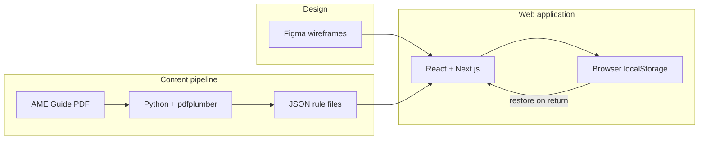

# Pilots Guide to Medical Certification

**CS-4273 Capstone — Fall 2026 | Group F**

A web platform that helps new pilots understand FAA medical certification: what is required, what to disclose, how to prepare for an Aviation Medical Examiner (AME) visit, and what to expect from issue, deferral, or denial outcomes.

This project continues work from prior OU Capstone teams (Fall 2025 / Spring 2026) and is designed for possible integration with FAA Office of Communication. Content must stay accurate, easy to find, easy to understand, and encouraging.

---

## Problem

Many newer pilots do not understand what an FAA medical certificate requires or how to move through the process successfully. Applicants with medical histories—including mental health concerns—often assume a piloting career is over before it starts.

Common pain points:

- Finding accurate information among conflicting sources
- Knowing what must be disclosed on MedXPress (Form 8500-8)
- Understanding what happens after disclosure (issue vs. deferral vs. denial)
- Preparing documentation before an AME exam
- Decoding medical terminology in plain language

---

## Goals

- Build a pilot-facing web platform within an **FAA-acceptable framework**
- Provide clear navigation and plain-language guidance for new pilots
- Ground all medical content in official FAA sources and mentor-approved material
- Continue the prior team's JSON content pipeline and prototype toward a production-ready experience
- Emphasize: get healthy first, see personal physicians for concerns, then pursue the medical certificate

---

## Key Feature (in development)

**Medical history wizard with auto-save**

A guided, multi-step flow that helps pilots “preflight” their medical exam:

- Walk through condition-specific checklists derived from AME Guide disposition rules
- Explain required documentation and realistic outcomes
- **Auto-save** progress to browser storage (`localStorage`) so users can leave and return without losing work
- Export saved progress as JSON (no real PII in the prototype)

> **Open question for mentor:** Whether auto-save should remain browser-only or move to a server-side database for cross-device sync.

---

## Technologies

| Technology | Role |
| --- | --- |
| **Python** | AME Guide PDF parsing, JSON content pipeline, automated tests |
| **JSON** | Structured AME rule data, wizard schemas, serialized save state |
| **HTML / CSS / JavaScript** | Web UI foundation, interactivity, responsive layout |
| **React + Next.js** | Accessible, navigable prototype application |
| **Figma** | Wireframes, UX prototypes, stakeholder review |
| **Browser storage** (`localStorage`) | Client-side auto-save for wizard progress |

### How they fit together



See [Step 1.a technology document](Assignments/Group/Ticket_2/src/Step1a_Identify_Technologies.md) for full rationale.

---

## Repository structure

```
CS-4273-Capstone/
├── README.md                          # This file
├── Resources/                         # Project brief, proposal, AME Guide PDF
├── Assignments/Group/                 # Course tickets and submissions
│   ├── Ticket_1/                      # Domain understanding
│   └── Ticket_2/                      # Technologies, README, unit tests
├── Spring2026/Capstone2026-main/      # Prior-semester Python pipeline + HTML prototypes
│   ├── AMEParser.py                   # Extract disposition rules from AME Guide PDFs
│   ├── AMESubset.py                   # Slice page subsets from the full guide
│   ├── AMEParserTests.py              # pytest unit tests
│   ├── ame_form.html                  # JSON-driven form prototype
│   ├── ame_subset.json                # Sample extracted rule data
│   └── ARCHITECTURE.md                # Pipeline architecture diagram
└── Notes/                             # Meeting notes
```

---

## Getting started

### Prerequisites

- Python 3.10+
- Node.js 18+ (for the planned Next.js frontend)
- [FAA AME Guide PDF](Resources/ame_guide.pdf) (place in `Spring2026/Capstone2026-main/` when running the parser)

### Python content pipeline (available now)

The rule-extraction tooling from Spring 2026 is ready to use:

```bash
cd Spring2026/Capstone2026-main

python -m venv .venv

# Windows
.venv\Scripts\activate

# macOS / Linux
source .venv/bin/activate

pip install -r requirements.txt
```

**Optional:** slice a page subset from the full AME Guide by editing and running `AMESubset.py`.

**Extract rules:**

```bash
python AMEParser.py ame_subset.pdf
```

**Run tests:**

```bash
python -m pytest AMEParserTests.py
```

Output is a JSON file (e.g. `ame_subset.json`) grouped by medical condition with checklist, decision, and follow-up fields.

**Try the HTML prototype:**

```bash
python -m http.server
```

Open `http://localhost:8000/ame_form.html` and load `ame_subset.json`.

### Next.js web app (planned)

The React + Next.js frontend is not scaffolded yet. Setup steps will be added here once the app directory is created.

---

## Progress plan

| Phase | Timeline | Deliverables |
| --- | --- | --- |
| **1. Domain & stack** | Weeks 1–2 | Domain understanding (Ticket 1), technology selection, README |
| **2. Design** | Weeks 2–4 | Figma wireframes for wizard and key flows; mentor feedback |
| **3. Content pipeline** | Weeks 2–5 | Extend Python parser coverage; validate JSON against AME Guide updates |
| **4. Frontend prototype** | Weeks 4–8 | Next.js app with wizard, auto-save, condition checklists from JSON |
| **5. Testing & refinement** | Weeks 8–10 | Unit tests (Python, JavaScript, third language); accessibility review |
| **6. Demo & handoff** | Weeks 11–15 | Presentation, user guide, report; prepare for FAA stakeholder review |

---

## Team

| Role | Name |
| --- | --- |
| Group ID | Group F |
| Team members | *[add names]* |
| Mentor / Client | *[add when confirmed]* |

---

## References

- [FAA Medical Certification](https://www.faa.gov/pilots/medical_certification)
- [FAA Guide for Aviation Medical Examiners](https://www.faa.gov/ame_guide)
- [MedXPress](https://medxpress.faa.gov/)
- [AOPA — Preflight your medical](https://www.aopa.org/news-and-media/all-news/2025/december/pilot/flight-md-preflight-your-medical)
- Project brief: [`Resources/Project info.md`](Resources/Project%20info.md)
- Capstone proposal: [`Resources/Capstone project proposal.pdf`](Resources/Capstone%20project%20proposal.pdf)

---

## Disclaimer

This is an educational prototype developed for CS-4273 Capstone. It is **not** an official FAA product. Medical content must be verified against current FAA guidance and mentor-approved sources. The prototype does not collect real personally identifiable information (PII).
