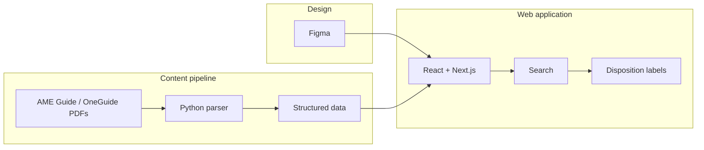

# Pilots Guide to Medical Certification

**CS-4273 Capstone - Fall 2026 | Group F**

A searchable web platform that helps pilots understand FAA medical certification: conditions and sub-conditions, likely outcomes (issue, deferral, or denial), deferral paperwork and tests, and how medications affect flight status.

This project continues prior OU Capstone work (Fall 2025 / Spring 2026) and is designed for possible integration with the FAA Office of Communication. Content should stay accurate, easy to find, easy to understand, and encouraging.

---

## Problem

FAA medical guidance is dense and examiner-oriented. Newer pilots often cannot tell what a condition means for their certificate, what an Aviation Medical Examiner (AME) will need, or whether a medication will affect flight status. Applicants with medical histories — including mental health concerns — sometimes assume a piloting career is over before it starts.

Common pain points:

- Finding accurate information among conflicting sources
- Identifying a condition and its related sub-conditions
- Knowing whether guidance points to issue, deferral, or denial
- Understanding deferral paperwork and tests early enough that approval is not delayed
- Checking how medications affect flight status
- Decoding medical terminology in plain language

---

## Goals

- Build a pilot-facing web platform within an **FAA-acceptable framework**
- Make certification information **searchable** and easy to navigate
- Present conditions, outcomes, deferral requirements, and medication guidance clearly
- Ground content in official FAA sources (parsed from AME Guide / OneGuide PDFs) and mentor-approved material
- Emphasize: get healthy first, see personal physicians for concerns, then pursue the medical certificate

---

## What we are building

The core product is **data presentation and search**. Pilots look up what they need and leave with a clear answer — not a multi-step wizard with saved progress.

| Area | What pilots get |
| --- | --- |
| **Search** | Find conditions, sub-conditions, medications, and related guidance |
| **Outcomes** | See whether guidance maps to **issue**, **deferral**, or **denial** |
| **Deferral readiness** | List paperwork, tests, and docs tied to a deferral path |
| **Medications** | See how a medication can affect flight status / certification |
| **Content source** | Structured data parsed from official PDFs this semester (external DB possible later) |

### Key feature (Ticket 2)

**Condition disposition classification** — take AME Guide–style disposition text and label it `ISSUE`, `DEFER`, `DENY`, `SPECIAL ISSUANCE`, or `UNKNOWN`. That label is what the UI can show as a clear outcome after search.

Documented with unit tests in Python, JavaScript, and C++:

- [Ticket 2 artifact](Assignments/Ticket_2/src/Ticket2_Artifact.md)
- Tests: `AMEParserTest.py` / `.js` / `.cpp` — run with `python Assignments/Ticket_2/src/run_all_tests.py`

---

## Technologies

| Technology | Role |
| --- | --- |
| **Python** | PDF parsing, content pipeline, disposition logic, pytest |
| **JavaScript** | Web interactivity; disposition helper + Node tests |
| **C++** | Ticket 2 third-language unit tests (GoogleTest) |
| **JSON** | Structured conditions, dispositions, deferral docs, medication notes |
| **HTML / CSS** | Web UI foundation and responsive layout |
| **React + Next.js** | Searchable, accessible presentation layer (planned) |
| **Figma** | Wireframes and stakeholder review |

### How they fit together



See [Step 1.a — Identify Technologies](Assignments/Ticket_2/src/Step1a_Identify_Technologies.md) and [Project Context and Requirements](Documentation/Resources/Project_Context_and_Requirements.md).

---

## Repository structure

```
Capstone-Fall2026/
├── README.md
├── Documentation/
│   └── Resources/                 # Briefs, proposals, AME Guide PDFs, requirements
├── Assignments/
│   ├── Ticket_1/                  # Domain understanding
│   └── Ticket_2/
│       ├── instructions/
│       └── src/
│           ├── Ticket2_Artifact.md          # Key feature + unit test write-up
│           ├── Step1a_Identify_Technologies.md
│           ├── AMEParserTest.py / .js / .cpp
│           ├── run_all_tests.py             # Run all three language suites
│           ├── AMEParser.py / AMESubset.py  # Pipeline copies for Ticket 2
│           └── CMakeLists.txt
├── src/
│   └── old/                       # Prior-semester Python pipeline (kept intact)
└── web/                           # Next.js (App Router, TypeScript) frontend
```

---

## Getting started

### Run Ticket 2 unit tests

Requires Python 3.10+, Node.js 18+, and CMake (for C++).

```bash
cd Assignments/Ticket_2/src
python run_all_tests.py
```

### Content pipeline (prior-semester tools)

Parser copies live under `Assignments/Ticket_2/src/` and `src/old/`. Place the AME Guide PDF where the scripts expect it, install dependencies (`pdfplumber`, `pypdf`), then run `AMEParser.py` on a PDF subset. Details remain in those scripts and the Ticket 2 artifact.

### Next.js app

Boilerplate lives in `web/` (App Router, TypeScript, Jest + React Testing Library).
Currently just an index page.

```bash
cd web
npm install
npm run dev    # http://localhost:3000
npm test       # Jest + React Testing Library
```

---

## Progress plan

| Phase | Timeline | Deliverables |
| --- | --- | --- |
| **1. Domain & stack** | Weeks 1–2 | Ticket 1 domain work; technology selection; README; Ticket 2 unit tests |
| **2. Design** | Weeks 2–4 | Figma wireframes for search and result views; mentor feedback |
| **3. Content pipeline** | Weeks 2–5 | Extend PDF parsing; structure conditions, outcomes, deferral docs, medications |
| **4. Frontend prototype** | Weeks 4–8 | Next.js app with search, disposition labels, deferral and medication info |
| **5. Testing & refinement** | Weeks 8–10 | Broader unit tests; accessibility review; content accuracy checks |
| **6. Demo & handoff** | Weeks 11–15 | Presentation, user guide, report; prepare for FAA stakeholder review |

---

## Team

| Role | Name |
| --- | --- |
| Group ID | Group F |
| Team members | James Cunningham, Colby Frison (product owner), Shone George Kutty Renjan, Patrick Ha, Alan Vo (sprint master) |
| Mentor / Client | Micheal Coffman, Rebecca Mauldin, Jesus J Viramontes |

---

## References

- [FAA Medical Certification](https://www.faa.gov/pilots/medical_certification)
- [FAA Guide for Aviation Medical Examiners](https://www.faa.gov/ame_guide)
- [MedXPress](https://medxpress.faa.gov/)
- [AOPA — Preflight your medical](https://www.aopa.org/news-and-media/all-news/2025/december/pilot/flight-md-preflight-your-medical)
- [Project info](Documentation/Resources/Project%20info.md)
- [Capstone project proposal (prior PDF)](Documentation/Resources/Capstone%20project%20proposal.pdf)
- [Formal project proposal (Fall 2026)](Documentation/Resources/Project_Proposal.md)
- [Project context & requirements](Documentation/Resources/Project_Context_and_Requirements.md)
- [Ticket 2 artifact](Assignments/Ticket_2/src/Ticket2_Artifact.md)

---

## Disclaimer

Educational prototype for CS-4273 Capstone. **Not** an official FAA product. Medical content must be verified against current FAA guidance and mentor-approved sources. The prototype does not collect real personally identifiable information (PII).
